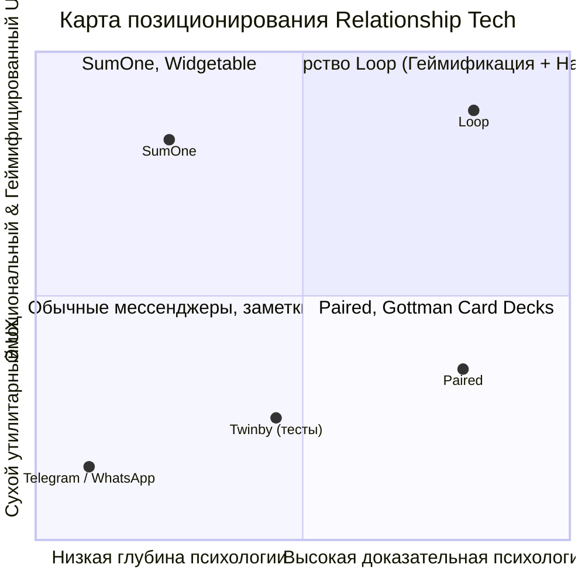
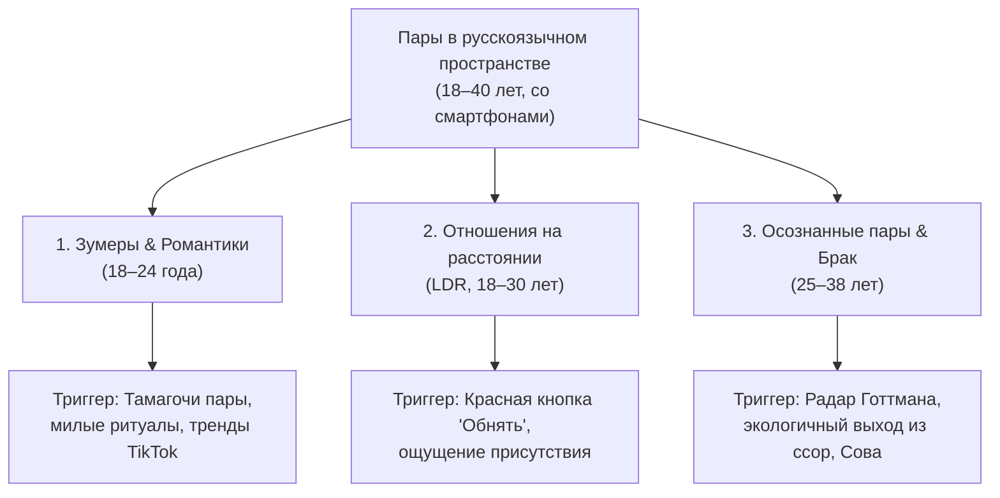
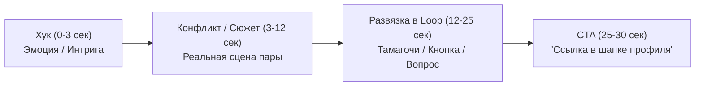
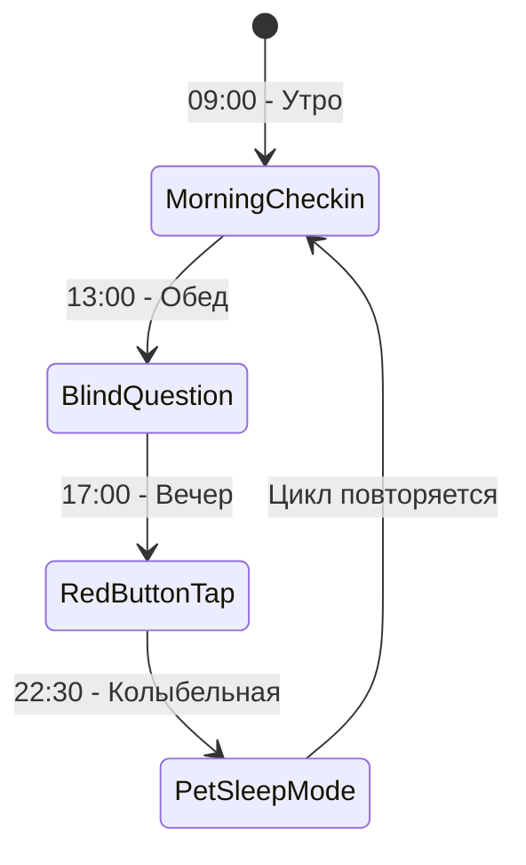
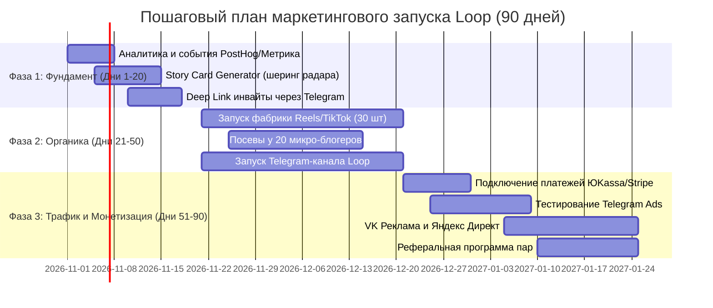

# 🚀 Комплексная маркетинговая стратегия и пошаговый план роста Loop

> **Продукт:** [Loop 💞 (loopza.vercel.app)](https://loopza.vercel.app) — Бережное PWA-пространство для пар  
> **Рыночный сегмент:** Relationship Tech / Couple Wellness & Casual Gamification  
> **Горизонт планирования:** 90–180 дней  
> **Ключевой фокус:** Product-Led Growth (PLG), органическая виральность через TikTok/Reels/Shorts, удержание (D30 Retention) и монетизация по подписке «Одна на двоих».

---

## 1. Резюме и позиционирование (Market Positioning)

### 1.1 Суть продукта и УТП
Loop объединяет три эмоциональных измерения отношений в одном бесшовном PWA-приложении:
1. **Ежедневный микро-контакт (Micro-rituals):** Большая Красная Кнопка «Обнять» (Haptic-вибрация, Web Audio сердцебиение, SSE-реалтайм) + Слепой вопрос дня (Blind Reveal — защита от конформизма).
2. **Вирусная геймификация (Shared Pet Tamagotchi):** Совместный питомец союза (котёнок/чихуахуа) в эстетике GameBoy с ночным сном под звёздами, decay-шкалами потребностей и прокачкой уровней союза (XP).
3. **Доказательная психометрика (Evidence-based Psychology):** 8 тестов (44 кейса), 24 шкалы, гексагональный Радар 6 сфер (Готтман, ЭФТ Джонсон, Стернберг) + бережный ИИ-психолог «Сова» (Llama 3.3 70b).

### 1.2 Матрица позиционирования (Конкурентный ландшафт)

| Конкурент | Фокус | Сильные стороны | Слабые стороны / Уязвимости | Преимущество Loop |
| :--- | :--- | :--- | :--- | :--- |
| **Paired** (UK/US) | Вопросы + уроки экспертов | Высокий авторитет, сильный бренд в US/EU | Дорогая подписка, нет геймификации, формальный тон | Игровой Тамагочи, тактильная кнопка «Обнять», доступная цена в РФ/СНГ |
| **SumOne** (Южная Корея) | Питомец EggMon + вопросы | Миллионная органика в TikTok, милый маскот | Нет глубокой доказательной психологии, нет ИИ-разборов ссор | Полноценный психологический радар 6 сфер + ИИ-медиатор «Сова» |
| **Agape** (US) | Ежедневные чекины | Фокус на ментальном здоровье | Однообразная рутина, быстро наскучивает | Мультисенсорный отклик, свидания, капсулы времени, вишлисты |
| **Дейтинг-аппы (Tinder, Twinby)** | Поиск партнёра | Огромный трафик | Заканчиваются в момент образования пары | **Loop подхватывает пару там, где дейтинг заканчивается** |



### 1.3 Слоган и ключевые месседжи
* **Главный слоган:** *«Loop — бережное пространство для двоих. Всё о вас в одном месте».*
* **Суб-слоган (для зумеров):** *«Растите общего питомца, обнимайтесь в 1 тап и узнавайте друг друга без масок».*
* **Суб-слоган (для пар в браке):** *«Отношения без автопилота: 5 минут в день для глубокого контакта».*

---

## 2. Сегментация аудитории и аватары (ICPs)



### Сегмент A: «Влюблённые зумеры» (18–24 года)
* **Боли:** Банальные переписки в Telegram, не знают, о чём говорить вечером, боятся показаться навязчивыми.
* **Что цепляет в Loop:** Общий питомец (чихуахуа или котёнок), которого нужно кормить вместе; слепой вопрос дня («а что он ответил?»); визуал в ретро-стиле GameBoy.
* **Каналы входа:** TikTok, Reels, VK Клипы, мемы в Telegram.

### Сегмент B: «Отношения на расстоянии (LDR)» (19–30 лет)
* **Боли:** Нехватка физической близости, разница часовых поясов, ощущение угасания связи.
* **Что цепляет в Loop:** Большая Красная Кнопка («Обнять») с вибрацией и звуком сердца; капсулы времени на будущую встречу; питомец как символ общего дома.
* **Каналы входа:** Тематические паблики про отношения на расстоянии, поисковый трафик («приложение для двоих на расстоянии»). Самый высокий LTV и готовность платить.

### Сегмент C: «Осознанные союзы & Молодые семьи» (25–38 лет)
* **Боли:** Бытовая рутина, мелкие взаимные претензии («он не слышит», «она закрывается»), угасание спонтанности.
* **Что цепляет в Loop:** Радар 6 сфер без оценочных суждений; алгоритм разрешения ссор по Готтману; ИИ-психолог «Сова»; Книга заботы (вишлисты без намёков).
* **Каналы входа:** Психологические блоги, подкасты, Telegram-каналы об осознанности, поиск («кризис в отношениях что делать»).

---

## 3. Product-Led Growth (PLG) и Вирусный контур ($K$-Factor)

Приложения для пар обладают уникальным природным преимуществом: **один пользователь не может использовать продукт в полную силу без приглашения второго**. Поэтому встроенный коэффициент виральности потенциально близок к $K \ge 1.0$.

### 3.1 Оптимизация петли приглашения (Couple Invite Loop)
1. **Персонализированная открытка-приглашение:**  
   Вместо сухой ссылки `loopza.vercel.app/pair?code=...` генерируется анимированная романтическая микро-страничка:
   > *«Максим создал для вас двоих уютное гнездо в Loop и выбрал питомца. Присоединяйся, чтобы дать ему имя и открыть ваш первый секретный вопрос дня!»*
2. **Мгновенный вход в 1 клик через Telegram:**
   Отправка кнопки-приглашения прямо в чат Telegram с deep link, открывающим сразу окно подтверждения союза.
3. **«Single-Player Mode» с триггером завершения:**
   Если партнёр ещё не скачал приложение, первый пользователь может:
   - Пройти тесты на привязанность и языки любви.
   - Увидеть тизер: *«Ваш индивидуальный профиль готов! Партнёру осталось пройти 6 вопросов, чтобы разблокировать ваш общий Радар совместимости»*.
   - Кнопка *«Напомнить любимому(ой) в Telegram»*.

### 3.2 Генератор эстетичных сторис-карточек (Shareable Artifacts)
Пользователи обожают делиться результатами тестов (феномен Spotify Wrapped, Twinby, 16Personalities):
- **Карточка 1: «Наш психологический архетип»** (Гексагональный радар 6 сфер + статус *«Надёжная гавань & Общий горизонт — 89% гармонии»*).
- **Карточка 2: «Наш питомец спит под звёздами»** (Милый пиксельный щенок/котёнок в ночном колпачке с подписью *«Мы заботимся о Барсике уже 45 дней в Loop»*).
- **Кнопка в приложении:** *«Поделиться в Stories / Telegram»* с водяным знаком `@loopza` и QR-кодом.

---

## 4. Контент-стратегия и Organic UGC Engine (TikTok / Reels / Shorts)

Короткие вертикальные видео — главный драйвер взрывного роста для приложений категории Couple Tech (опыт SumOne и Widgetable).



### 4.1 Четыре вирусных формата (Content Pillars)

#### Формат 1: «Слепой вопрос дня» (Интрига и реакция)
* **Сценарий:** Девушка показывает экран телефона: *«В Loop появился вопрос дня: "Какой мой поступок заставил тебя влюбиться заново?". Мой ответ заблокирован замочком, пока он не напишет свой»*. Камера переводится на парня, который сосредоточенно печатает. Звук щелчка замка 🔓 — оба ответа открываются. Искренняя реакция.
* **Звук:** Трендовый сентиментальный или мемный саундтрек.

#### Формат 2: «Красная кнопка "Обнять" посреди дня» (Тактильность)
* **Сценарий:** Сплит-скрин. Парень на скучной лекции или совещании. Девушка дома нажимает Большую Красную Кнопку. У парня на телефоне раздаётся звук биения сердца, телефон вибрирует и экран осыпается сердечками. Парень улыбается и отправляет ответное объятие в 1 тап.
* **Текст на экране:** *«Когда вам не нужны слова, чтобы почувствовать друг друга»*.

#### Формат 3: «Драма с Тамагочи пары» (Юмор и милота)
* **Сценарий:** *«POV: Вы поругались, но вам всё равно нужно вместе покормить общего чихуахуа в Loop, чтобы он не грустил в ночном колпачке»*.
* **Визуал:** Показ экрана консоли GameBoy, питомец сопит `z-Z-Z`.

#### Формат 4: «Разбор ссоры через ИИ-Сову» (Психологическая глубина)
* **Сценарий:** *«Вместо того чтобы дуться 3 дня, мы загрузили нашу претензию Сове. Вот как метод Готтмана перевёл "Ты вечно сидишь в телефоне" на язык любви без криков»*.

### 4.2 План производства контента
* **Объем:** 1–2 ролика в день (30–45 роликов в месяц) с кросс-постингом: **TikTok, Instagram Reels, YouTube Shorts, VK Клипы**.
* **Инфлюенс-маркетинг (Seeding):**
  - Работа с 20–30 микро-инфлюенсерами (пары 5k–50k подписчиков, lifestyle, отношения на расстоянии).
  - Формат сотрудничества: бартер (пожизненный Loop Premium) + оплата за просмотры (CPA / фиксированная ставка за ролик с охватом от 10k).

---

## 5. Performance Marketing и платный трафик

| Канал | Таргетинг / Аудитория | Формат креатива | Ожидаемый CPC/CPA | Целевое действие |
| :--- | :--- | :--- | :--- | :--- |
| **Telegram Ads** | Каналы психологии отношений, каналы для девушек, кино/свидания, блоги пар | Короткий текст (до 160 симв.) + кнопка перехода в бот/веб | CPC 15–35 ₽, CPA союза 120–250 ₽ | Создание союза |
| **VK Реклама** | Статусы «В отношениях» / «Помолвлен(а)», интересы «Психология», «Подарки», «Романтика» | Карусель экранов (Тамагочи, Радар, Кнопка «Обнять») | CPC 12–28 ₽, CPA союза 150–300 ₽ | Установка PWA |
| **Яндекс Директ (Поиск + РСЯ)** | Ключи: *приложение для двоих*, *тесты для пар на совместимость*, *игры для пар на расстоянии* | Текстово-графические смарт-баннеры с калькулятором совместимости | CPC 25–60 ₽, CPA 200–450 ₽ | Регистрация |
| **Интеграции в Telegram-каналах** | Авторские каналы психологов, каналы с мемами про отношения | Нативный пост-история с разбором радара отношений автора | CPM 250–500 ₽ | Переход по реф-ссылке |

---

## 6. Retention, CRM и Habit Loops (Удержание пар)

Основная метрика долгосрочного успеха Loop — **D30 Retention пар**. Пара должна сформировать устойчивую привычку ежедневного захода.



### 6.1 Матрица умных триггерных Web Push уведомлений

| Время / Триггер | Получатель | Заголовок и текст пуша | Цель уведомления |
| :--- | :--- | :--- | :--- |
| **09:30 (Утро)** | Партнёр А | ☀️ *«Доброе утро! Отправь тёплое касание [Имя] перед началом дня»* | 1 клик на кнопку «Обнять» |
| **13:00 (День)** | Оба | 🔒 *«Новый секретный вопрос дня уже ждёт! Узнайте, о чём мечтает ваша половинка»* | Переход в слепой вопрос |
| **Событийный** | Партнёр Б | 🔓 *«[Имя] только что ответил(а) на вопрос! Напишите свой, чтобы снять замок»* | Механика взаимного открытия |
| **19:00 (Вечер)** | Оба | 🐾 *«Ваш питомец проголодался и ждёт лакомств. Покормите его вместе!»* | Совместный уход за Тамагочи |
| **23:00 (Ночь)** | Оба | 🌙 *«Пора укладывать малыша спать в ночном колпачке. Спокойной ночи вашему союзу!»* | Закрытие дневного стрика |
| **Событийный** | Партнёр | ❤️ *«[Имя] крепко обнимает вас прямо сейчас! Ответить взаимностью?»* | Мгновенный тактильный отклик |

### 6.2 Геймификация стриков (Couple Streaks)
- **Стрик не прерывается, если оба партнёра сделали хотя бы 1 действие в день** (покормили питомца, ответили на вопрос или нажали «Обнять»).
- Награды за дни: 7 дней (бейдж «Первая искра»), 30 дней (секретный костюм для питомца), 100 дней (юбилейная капсула времени).

---

## 7. Монетизация и юнит-экономика (Monetization Strategy)

### 7.1 Модель «Одна подписка на двоих» (Pair Subscription)
Психологический барьер: в отношениях странно, если платят оба. Платит один партнёр — премиум активируется сразу для обоих.

```text
┌────────────────────────────────────────────────────────────────────────┐
│                          ТАРИФНЫЕ ПЛАНЫ LOOP                           │
├─────────────────────────┬────────────────────────┬─────────────────────┤
│ Тариф                   │ Цена (РФ / СНГ)        │ Цена (Global)       │
├─────────────────────────┼────────────────────────┼─────────────────────┤
│ 🆓 Free (Базовый)       │ 0 ₽                    │ $0                  │
│ • Питомец (базовый уход)│                        │                     │
│ • Слепой вопрос дня     │                        │                     │
│ • Большая кнопка «Обнять»│                       │                     │
│ • 2 базовых теста       │                        │                     │
├─────────────────────────┼────────────────────────┼─────────────────────┤
│ 💎 Loop Plus Месяц      │ 490 ₽ / месяц          │ $4.99 / mo          │
│ 💎 Loop Plus Год (-40%) │ 2 990 ₽ / год (249 ₽/м)│ $34.99 / yr         │
│ 🎁 Навсегда (Lifetime)  │ 5 990 ₽ единоразово    │ $59.99 lifetime     │
│ (Идеально для свадеб)   │                        │                     │
└─────────────────────────┴────────────────────────┴─────────────────────┘
```

#### Что входит в Loop Plus:
* Полный доступ ко всем 8 психологическим тестам и глубокой матрице 24 шкал.
* Неограниченные диалоги и разборы конфликтов с ИИ-психологом «Сова».
* Эксклюзивные скины питомцев и ретро-консолей GameBoy.
* Безлимитный фотоархив и капсулы времени без ограничений по сроку.
* Расширенные сценарии свиданий в Колесе свиданий.

### 7.2 Целевая юнит-экономика (Benchmark Model)
* **CAC (стоимость привлечения пары):** $\le 300\text{ ₽}$ (с учётом вирального коэффициента $K=0.8$).
* **Конверсия из зарегистрированной пары в платящую (Free to Paid):** $4.5–6.0\%$.
* **Средний чек ( blended ARPU):** $1 800\text{ ₽}$ (с учётом годовых планов).
* **LTV (Lifetime Value):** $2 200–3 500\text{ ₽}$.
* **Соотношение LTV / CAC:** $\ge 5.0\times$ (высокомаржинальная SaaS-модель).

---

## 8. Пошаговый 90-дневный план действий (Step-by-Step Roadmap)



### Фаза 1: Подготовка фундамента и продуктовой виральности (Дни 1–20)
- [ ] **Шаг 1.1: Сквозная аналитика:**
  - Настроить сбор событий в Яндекс Метрике и Amplitude/PostHog: `register_success`, `pair_request_sent`, `pair_connected`, `pet_born`, `daily_question_answered`, `hug_tap`, `radar_viewed`.
- [ ] **Шаг 1.2: Виральный генератор сторис (Shareable Card):**
  - Разработать экран/кнопку «Поделиться результатами союза»: красивая плашка с радаром 6 сфер, архетипом пары и маскотом, адаптированная под формат $9:16$ (Instagram Stories, Telegram Stories, VK).
- [ ] **Шаг 1.3: Оптимизация инвайт-флоу:**
  - Добавить предзаполненное сообщение для Telegram: *«Я выбрал(а) для нас питомца в Loop! Заходи, чтобы дать ему имя: [ссылка]»*.

### Фаза 2: Organic Growth и фабрика коротких видео (Дни 21–50)
- [ ] **Шаг 2.1: Оформление соцсетей бренда:**
  - Создать и оформить брендовые аккаунты: TikTok (`@loopza`), Instagram (`@loopza.app`), Telegram-канал («Loop: Пространство для двоих»), VK сообщество.
- [ ] **Шаг 2.2: Производство и публикация первых 30 видео:**
  - 10 роликов с интригой слепого вопроса дня.
  - 10 роликов про Тамагочи пары (ночной сон, забыли покормить, реакция парня).
  - 5 роликов про Большую Красную Кнопку «Обнять» посреди работы.
  - 5 экспертных разборов частых ссор с решением через Сову.
- [ ] **Шаг 2.3: Бартерные посевы у микро-блогеров:**
  - Отобрать 20 парных аккаунтов (5k–50k подписчиков), предложить ранний доступ и совместный тест совместимости.

### Фаза 3: Платный трафик, подключение подписки и масштабирование (Дни 51–90)
- [ ] **Шаг 3.1: Внедрение Paywall и платёжного шлюза:**
  - Подключить эквайринг (ЮKassa для карт РФ/СБП + Stripe/Cryptomus для зарубежных пользователей).
  - Сделать экран выбора подписки (с бесплатным 7-дневным триалом на тариф «Год»).
- [ ] **Шаг 3.2: Запуск Telegram Ads и контекстной рекламы:**
  - Тестирование 5 когорт каналов в Telegram Ads с бюджетом от 500 €.
  - Запуск поисковой кампании в Яндекс Директ по горячим запросам.
- [ ] **Шаг 3.3: Запуск реферальной программы «Приведи пару друзей»:**
  - Механика: *«Поделитесь промокодом с парой друзей. Когда они подключатся к Loop, обе пары получают +1 месяц Loop Plus бесплатно»*.

---

## 9. Метрики успеха (KPIs)

| Метрика | Этап soft-launch (30 дней) | Этап масштабирования (90 дней) |
| :--- | :--- | :--- |
| **Количество активированных пар** | 1 000 пар | 15 000 пар |
| **Конверсия инвайта ($A \to B$)** | $\ge 65\%$ приглашённых подключаются | $\ge 75\%$ |
| **D1 Retention пар** | $\ge 60\%$ | $\ge 68\%$ |
| **D7 Retention пар** | $\ge 35\%$ | $\ge 42\%$ |
| **D30 Retention пар** | $\ge 20\%$ | $\ge 26\%$ |
| **Охваты в TikTok / Reels / Shorts** | 250 000 просмотров/мес | 2 500 000 просмотров/мес |
| **Конверсия в платную подписку** | $3.5\%$ | $5.5\%$ |
| **MRR (Monthly Recurring Revenue)** | 150 000 ₽ | 1 200 000 ₽ |

---

## 10. Риски и стратегии их минимизации

1. **Риск: «Один партнёр хочет пользоваться, второй ленится или забывает».**
   - *Решение:* Сверхнизкий порог действий для второго партнёра (1 тап на объятие или выбор эмодзи-реакции на вопрос дня занимает 3 секунды; пуш-напоминания с милым маскотом снимают сопротивление).
2. **Риск: «Пользователи забывают возвращаться после прохождения всех 8 тестов».**
   - *Решение:* Decay-механика Тамагочи (питомец требует ухода каждый день), динамические еженедельные чекины пульса союза и регулярное пополнение банка вопросов дня и свиданий.
3. **Риск: «Ограничения PWA на iOS (пуши требуют добавления на Home Screen)».**
   - *Решение:* Интерактивный 2-шаговый подсказчик в Safari: *«Нажмите "Поделиться" ⎋ → "На экран «Домой»" ⊞, чтобы получать объятия партнёра со звуком»* + отправка уведомлений-дублеров через Telegram-бота союза.
