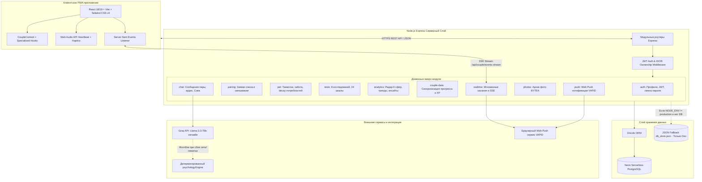

> Эта страница предназначена для инженеров, архитекторов и DevOps-специалистов, документируя устройство сервиса, потоки данных и принципы отказоустойчивости Loop v3.0.0.

# Архитектура системы (Architecture)

## Общая схема компонентов

Архитектура Loop построена по модульной схеме с полным разделением клиентского UI-слоя, доменных серверных сервисов, базы данных PostgreSQL и внешних сервисов реалтайма и ИИ.

---

## Архитектурные принципы и надёжность

### 1. Архитектура виртуального питомца (Tamagotchi Engine)
- **Таблица `couple_pets`**: Хранит текущее состояние (вид: собака/кошка, имя, голод, радость, энергия, чистота, настроение, уровень, опыт, время последних активностей).
- **Серверный Decay-алгоритм**: При каждом запросе `GET /api/pet` или действии сервер рассчитывает угасание показателей с момента `lastFedAt`, `lastPlayedAt`, `lastCleanedAt`, `lastSleptAt`.
- **Ночной режим (Night Sleep State)**: Если энергия падает ниже критического уровня или наступает ночное время, питомец переводится в состояние сна (`sleeping`), визуализируя ночной колпак, подушку и спящую позу.
- **Realtime Синхронизация**: При кормлении или играх одним партнёром второй партнёр мгновенно получает событие `pet_updated` через Server-Sent Events (SSE).

### 2. Мультисенсорный движок тактильности (Haptics & Web Audio)
- **Автономный синтез звука**: Модуль `src/utils/soundFx.ts` использует нативный `Web Audio API` для синтеза звуков (биение сердца при касании, радостный писк Тамагочи, клик кнопок) без загрузки внешних аудиофайлов через сеть, гарантируя нулевую задержку ($<5\text{ms}$).
- **Haptic Vibration API**: При тапе по Большой Красной Кнопке вызывается паттерн вибрации `[60, 40, 90]`, создающий реалистичное физическое ощущение двойного удара сердца.

### 3. Мобильная геометрия и эргономика (Mobile-First Architecture)
- **Устранение дублирования DOM**: Навигация разделена на проп `variant: 'bottom' | 'sidebar'`. На мобильных устройствах нижний таб-бар фиксирован внизу с учётом безопасной зоны `env(safe-area-inset-bottom)`.
- **Автоскрытие таб-бара в чате**: Полноэкранный `ChatView` активирует селектор `body.in-chat-view .bottom-nav`, скрывающий нижнюю панель и отдающий $100\%$ высоты экрану диалога и наэкранной клавиатуре.
- **Защита от автозума в iOS Safari**: Для всех `<input>` и `<textarea>` на экранах $\le 768\text{px}$ принудительно задан `font-size: 16px`, блокирующий неприятное масштабирование страницы.

### 4. Строгая Fail-Fast политика в Production
В продакшн-окружении (`NODE_ENV=production`) сервер не допускает запуск без критических переменных:
- **`DATABASE_URL`**: При отсутствии или недоступности Neon PostgreSQL процесс немедленно завершается с фатальной ошибкой (`FATAL`). Файловый фоллбэк в проде **категорически отключён**.
- **`JWT_SECRET`**: Использование дефолтных или слабых ключей в проде запрещено; отсутствие валидного секрета приводит к аварийному завершению.

### 5. Отказоустойчивость ИИ-психолога (AI Fallback Chain)
Для ответов Совы реализована двухуровневая отказоустойчивая схема:
1. Запрос к **Groq API** (`llama-3.3-70b-versatile` / `qwen/qwen3.8-27b`).
2. При сбое сети или исчерпании лимитов управление мгновенно передаётся встроенному модулю `psychologyEngine.ts`, который детерминированно формирует структурированный ответ по формуле Готтмана (*Взгляд психолога → Практика → Вопрос для пары*).

### 6. Изоляция данных пары (IDOR Prevention)
Каждый маршрут пары защищён middleware `requirePairOwnership`. Ключ пары `pairKey` детерминированно формируется из логинов участников: `[login, partnerLogin].sort().join('_')`. Доступ к чужим данным пресекается со статусом 403 Forbidden.

---

*Спецификация маршрутов API представлена на странице [Справочник API (API-Reference)](API-Reference).*
